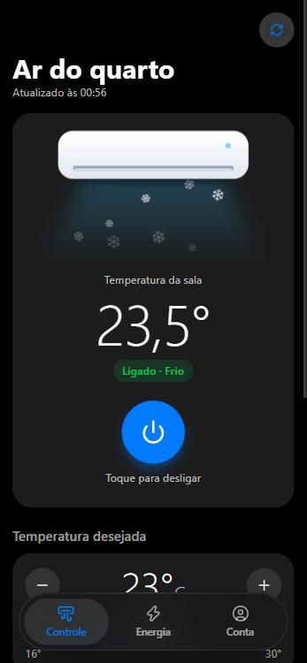
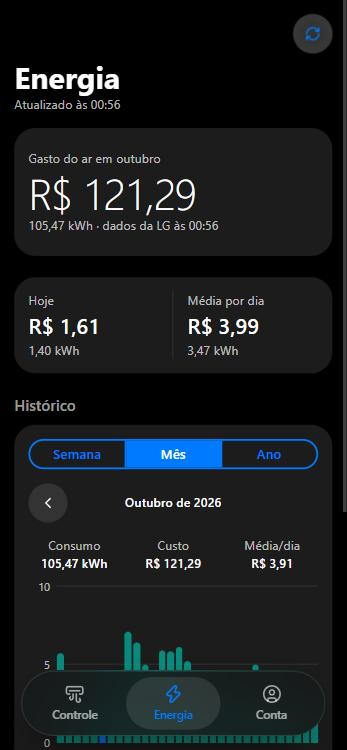
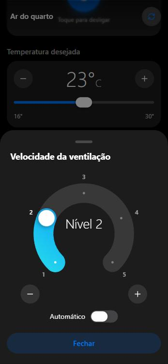
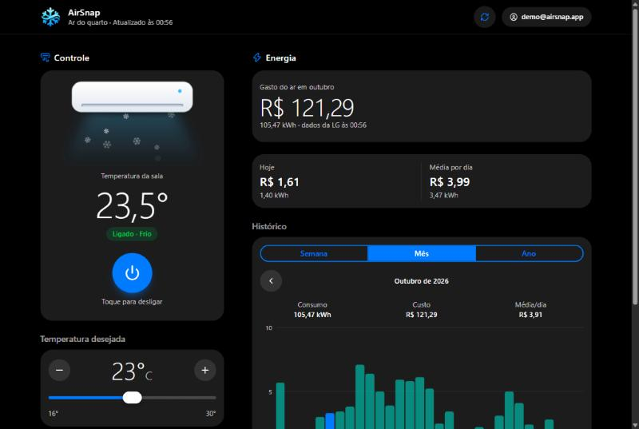
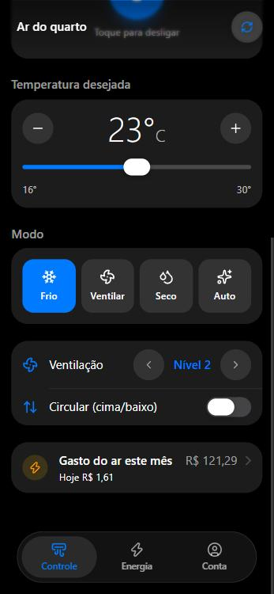
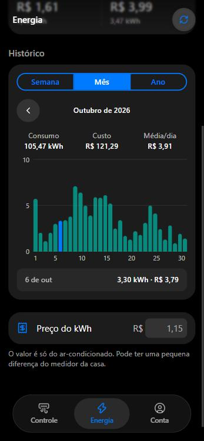
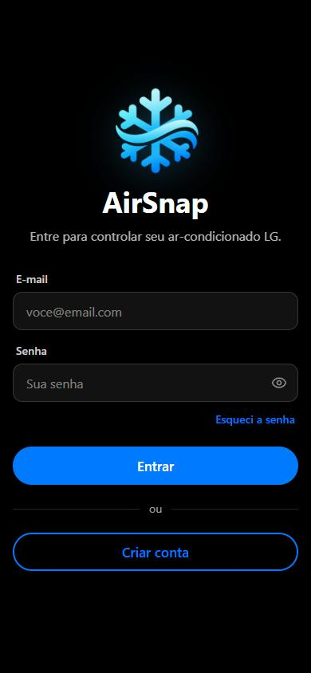
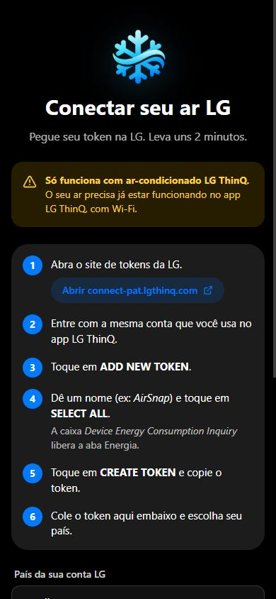

<p align="center">
  
</p>

# AirSnap

Controle o seu ar-condicionado LG e veja quanto ele gasta em reais, sem esperar loading.

*A fast web app to control an LG ThinQ air conditioner and track its energy cost.*

**Acesse: [airsnap-kohl.vercel.app](https://airsnap-kohl.vercel.app)**

<p align="center">
  
  
  
</p>

<p align="center">
  
</p>

> Os prints usam dados de demonstração.

## Por que existe

O app oficial LG ThinQ vive travado em loading infinito. O AirSnap abre na hora com o último estado salvo e atualiza em segundo plano. Faz só o que importa no dia a dia: ligar, mudar temperatura, modo, ventilação e ver o gasto.

> Só funciona com **ar-condicionado LG** conectado ao app **LG ThinQ**. O AirSnap não é um app oficial da LG.

## O que o app faz

**Controle**
- **Liga e desliga** com um toque, com animação do ar soltando flocos de neve no modo frio.
- **Temperatura desejada** com − / + e barra deslizante. Vários toques viram um comando só.
- **Modo**: frio, ventilar, desumidificar, automático e os outros que o aparelho tiver.
- **Ventilação** em arco, do nível 1 ao 5, ou automático. Igual ao seletor do app da LG.
- **Circular** liga o vai-e-vem da aleta.
- **Vários aparelhos** na mesma conta.

<p align="center">
  
  
</p>

**Energia**
- **Gasto do mês até agora** em R$, com o horário em que a LG mandou o dado.
- **Hoje** e **média por dia**, em reais e kWh.
- **Histórico** por semana, mês e ano, com navegação para períodos anteriores.
- **Preço do kWh** ajustável (padrão R$ 1,15).
- Só dado real da LG. Nada de estimativa ou previsão.

**Conta**
- Cadastro, login, recuperar senha e excluir conta.
- Passo a passo para gerar o token pessoal na LG e conectar o seu ar.

<p align="center">
  
  
</p>

**Celular e computador**
- No celular: abas Controle, Energia e Conta, com visual de iOS. Dá pra instalar na tela inicial (PWA).
- No computador: um painel só, com controle e energia lado a lado.

## Tecnologias

- **React 19** + **TypeScript** (estrito)
- **Konsta UI** (componentes iOS, tema escuro) + **Tailwind CSS v4**
- **Vite**
- **Supabase** (Auth + Postgres)
- **Vercel Functions** para falar com a API **LG ThinQ Connect**
- **lucide-react** para os ícones

## Decisões de projeto

- **Cache primeiro**: o último estado e a energia ficam salvos no aparelho. A tela abre na hora, sem esperar a LG.
- **Tela otimista**: o comando aparece na tela antes da resposta da LG e volta atrás se falhar.
- **Fila de comandos**: o ar recusa comandos muito seguidos. Cada comando espera 1,5 s do anterior e tenta de novo até 2 vezes.
- **Aviso no centro**: ao enviar, aparece "Enviando…" e depois um check verde ou um X vermelho. Enquanto envia, a tela não aceita toques.
- **Token só no servidor**: o navegador nunca vê o token da LG.
- **Konsta UI primeiro**: componente próprio só quando o Konsta não resolve bem (inputs, gráfico, seletor em arco, barra de abas).
- **Acessibilidade**: texto de no mínimo 14 px, bom contraste, alvos de toque de 44 px e animações que respeitam "reduzir movimento".

## Segurança

- Login, confirmação de e-mail e recuperação de senha pelo **Supabase Auth**.
- O token da LG é guardado criptografado com **AES-256-GCM**, amarrado ao id do usuário. Quem lê o banco não consegue usar o token.
- A tabela de tokens tem **RLS** ligado e nenhum acesso pelo navegador. Só o servidor lê.
- Toda chamada passa pelo servidor, que confere o login e usa só o token do próprio usuário.
- O token é testado na LG antes de ser salvo, e só entra conta que tenha ar-condicionado.
- O servidor só libera as rotas que o app usa e confere cada parâmetro.

## Limites da API da LG

- A posição da aleta não existe na API oficial. Dá só pra ligar ou desligar o vai-e-vem.
- A energia vem por dia e por mês. Não existe consumo por hora nem "agora".

## Estrutura

```
api/
  lg.ts               servidor: confere o login, decifra o token e fala com a LG
src/
  lib/                lógica pura (ar, energia, formatação, chamadas)
  hooks/              estado (useAirConditioner, useEnergy, useAuth...)
  components/         telas e peças de interface
supabase/
  schema.sql          tabela dos tokens, com RLS
scripts/
  setup-env.ts        cria o .env.local e gera a chave de criptografia
public/               logo, ícones e manifest do PWA
docs/screenshots/     prints deste README
```

## Rodar localmente

Precisa de Node 22+ e um projeto no Supabase.

```sh
npm install
npm run setup-env
```

Preencha o `.env.local` com a URL e as chaves do Supabase. Rode `supabase/schema.sql` no SQL Editor do Supabase. Depois:

```sh
npm run dev
```

Abre em `http://localhost:3000`, com o servidor da LG junto.

## Como foi feito

Desenvolvido com agentes do **Claude Code**, seguindo as regras do [AGENTS.md](AGENTS.md): sem comentários no código, Konsta UI primeiro, toda tela centralizada e acessibilidade em todas as telas.

---

- [AGENTS.md](AGENTS.md): regras do projeto e notas da API da LG
- [supabase/schema.sql](supabase/schema.sql): banco e permissões
- [API ThinQ Connect](https://connect-pat.lgthinq.com): onde gerar o token pessoal
